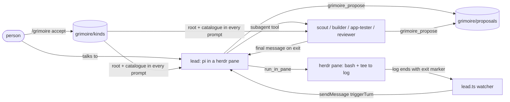

# AGENTS.md

sitra is a Pi package plus a small CLI. One package, no workspace. Read this before changing anything, and read
[docs/LEARNINGS.md](docs/LEARNINGS.md): each item there cost real hours.

## Layout

| Path | What it is |
|---|---|
| `extensions/grimoire.ts` | Grimoire core: entry format, store, root loading, catalogue, search, import from `/kb`. No Pi imports. |
| `extensions/grimoire-ui.ts` | Local Grimoire web UI server (`127.0.0.1`, token + `Host` check), snapshot, CRUD, link repointing and day log. No Pi imports. |
| `extensions/grimoire-ui-pi.ts` | Pi wiring for `/grimoire-ui`: starts the local server, opens the default browser, stops on `session_shutdown`. |
| `extensions/replycheck.ts` / `replycheck-pi.ts` | The end-of-reply PR check: PR links the agent didn't look up this turn are checked with `gh` before the reply settles. |
| `extensions/knowledge.ts` | Pi extension: Grimoire in every prompt, `grimoire_propose`, `grimoire_search`, `/grimoire`, `/grimoire-reflect`, the status line. |
| `extensions/lead.ts` | Pi extension: the lead's rules (lead only, never teammates), the context-file filter, `run_in_pane` / `check_run`, the herdr "needs you" signal. |
| `extensions/runs.ts` | Pure helpers for `run_in_pane`: the bash command that logs output and the exit code, and reading a log back. |
| `extensions/sessions.ts` | Session registry, inbox messages, alerts, and friction audit across worker sessions. No Pi imports. |
| `extensions/tower.ts` | Pi extension: records every session, delivers between-step inbox messages, and gives the tower its tools and `/radar`. |
| `extensions/sharpen.ts` | Keeping long conversations sharp: stubbing old tool output, helper hand-off briefs, the handover threshold and instructions. No Pi imports. |
| `extensions/sharpen-pi.ts` | Pi wiring for it: the `context` handler, subagent task briefs, early handover and `/handover`. |
| `extensions/radar.ts` | Local workspace/run snapshots and terminal primitives. `radar-model.ts` owns keyboard/navigation; `radar-view.ts` allocates the bounded viewport; `radar-runtime.ts` wires the terminal; `radar-store.ts` owns explicit status and read-only local mail sources. See [radar controls and data](README.md#radar-controls-and-data). |
| `cli/` | `sitra init`, `sitra grimoire` (Claude Code / Codex hooks, import) and the launcher's pure parts: versions, config (`~/.sitra`), profile scaffolding, Pi arguments and environment. |
| `bin/sitra.ts` | The `sitra` command: wires `cli/` to the real terminal, filesystem and processes. Keep logic out of it. |
| `templates/profile/` | Copied into `~/.sitra/profile` by `sitra init`, with `{{name}}` filled in. Never overwrites existing files. |
| `templates/rpiv-ask-user-question.json` | The question tool's guidance, written only if the person has none. |
| `test/` | Vitest. `*.e2e.test.ts` start a real `pi` in RPC mode with a scripted faux model (`test/fixtures/`), so no API key. |

## How it runs

- `sitra` sets `PI_CODING_AGENT_DIR=~/.sitra/profile`, `PI_MEMORY_DIR` and `SITRA_USER_NAME`, then runs `pi`.
- Teammates get `PI_SUBAGENT_NAME` from pi-subagents; `lead.ts` uses it to give the lead's rules to the lead only.

## Rules for changing it

- `pnpm check` is the gate: type-check, Biome, Vitest. It must be green before every commit.
- Red/green TDD: write the test first, stub the module so the test runs and fails on its assertions, predict the
  pass/fail counts, then implement.
- Keep pure logic in `extensions/grimoire.ts`, `extensions/runs.ts` and `cli/`; keep the Pi and process wiring thin.
- Pin every Pi package in `cli/init.ts` `PACKAGES` to a version (or git commit) released at least 7 days earlier.
- Templates speak to `{{name}}` with they/them. Nothing person- or company-specific belongs in this repo.
